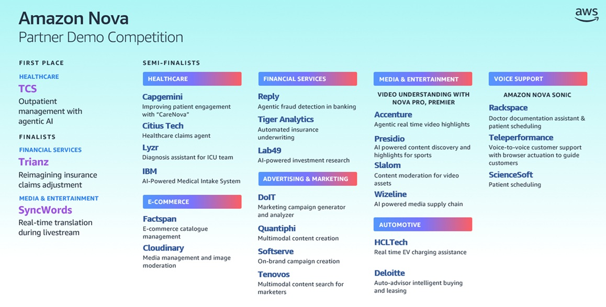

> In 2025, at Trianz, one of my former employers and a **digital consulting company**, I built a **real-time agentic voice assistant** that automates **insurance claims adjustment** through natural conversation, powered by Amazon Nova Sonic and Nova Pro, multimodal LLMs from Amazon Bedrock. It secured **global runner-up recognition** in the 2025 Amazon Nova Partner Demo Competition hosted by AWS, outperforming **leading global consulting firms** such as **Deloitte and Accenture**. I also presented and explained the solution as part of the competition demo.

🏆 **Official AWS Recognition:** [2025 Amazon Nova Partner Demo Competition Winners](https://aws.amazon.com/blogs/apn/celebrating-innovation-announcing-the-2025-amazon-nova-partner-demo-competition-winners/)

🎥 **My presentation:** [Watch the solution demo (3:01)](https://www.youtube.com/watch?v=xyfuDkDKELg&t=181s) *(Featured in the official AWS announcement above).*

> I graduated with a Bachelor of Technology (B.Tech) degree in **Information Technology**, scoring **92.66%** (**First Class with Distinction**) and ranking **2nd out of 200 students** during all four years of the programme.

Beyond my professional work, I build end-to-end, open-source systems in my own time. They push the same ideas I use at work further, and each one is a complete working project, listed here with everything it uses:

